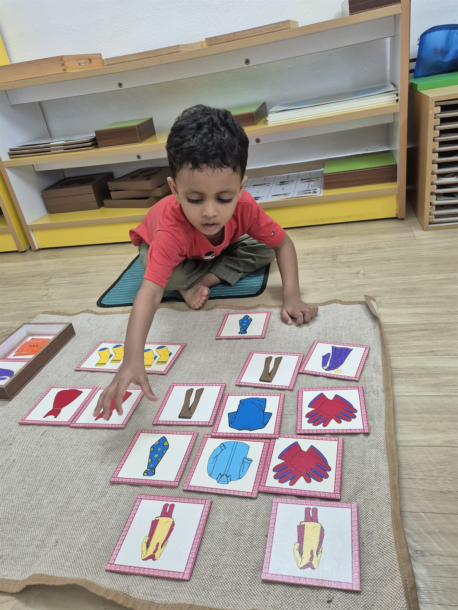
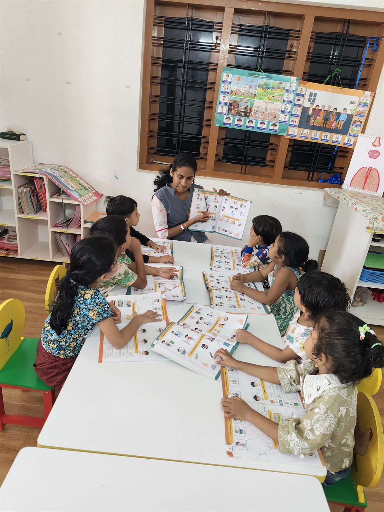

Children's Day in India is 14 November, Jawaharlal Nehru's birthday. He was fond of children, and the country still marks the day for that reason. A young child will not hold the history. They will hold the morning.

What does a young child in Kaloor actually need from the adults around them? Time. Attention that stays. Room to try.

## Time, and attention that stays

A child can tell when you are in the room and when you are really with them. The difference is pace.

In a Montessori classroom a teacher often sits on the floor and waits. A child pours from a small jug. The last drops take a while. Nobody says hurry. Other children are on their own mats. The room is busy. It is not rushed.

At home it is shoes by the door, or a shirt on backwards the first time. The phone can wait in another room. A few unhurried minutes still fit in a full Kochi morning.

## Help me to do it myself

Young children want the job. You see it when a small hand pushes yours away from the shoe. The need is easy to name. Help me to do it myself.

Help is not doing it for them. Show the step once, then move your hands away. A button. A jug. In the classroom a child takes a mat, chooses the work, and puts it back. The adult stays near enough if the jug tips, and far enough that the work still feels like the child's.

At home, let them wash the cup they used. Water will go on the counter. Hand them the cloth. A child who is always rescued learns to wait for someone else.

## Respect for their pace

Some children return to the same work every morning for a long stretch. That can look stuck. Often they are settling. The hand wants one more turn. The work is not swapped because an adult is bored, or because the shelf has something new.

At home, dressing may be slow. A story may need telling twice. A child rushed from bed to the door arrives already tight. Given their own pace, they arrive with something left.

## Freedom within limits

Freedom for a young child is a real choice inside edges they can see. It is not a free-for-all.

In the classroom a child may choose their work. They may not take another child's materials off a mat. Things go back to their place. At home, two shirts is a real choice. The whole cupboard, while you are late, is not. Offer a choice you can keep.

## Real work

Children know a real job from a job invented to keep them busy. They want the first kind. Wiping a table. Setting a plate. Watering a plant. Peeling a banana.

In the classroom the tools are real: a cloth, a jug, a button, a small broom. A Kochi kitchen already has the same work. Rinse the coriander. Fold a napkin. Stir, if they can reach. Stay close. Ordinary work is the kind they take seriously.

## Being listened to

Listening at this age is mostly waiting. An adult comes down to the child's height and lets the sentence arrive. It may be about a button, or about something seen on the way in. What matters is that someone stayed.

A book can be this kind of listening. A teacher sits with a few children, each with an illustrated book open, and stays while they look. There is no quiz at the end of the page.

At home, the long story of an ant on the compound wall is easy to cut short. Try not to. You do not have to turn it into a lesson.

## Play, and time outside

Work is not the whole day. Children need to run, dig, and be loud. At school, going outside belongs with the mats. It is not a prize for sitting still.

At home, a garden, a terrace, or the path outside will do. In Kochi, morning and late afternoon are the kind hours. A stick, a puddle after rain, a ball. Follow their idea for a while before you improve it.

## A day that is not about a gift

If you mark the day at home, on the 14th or a morning near it, keep it simple. The point is the time, not the parcel.

Start slowly. Breakfast without the clock in your voice.

Let your child plan one small part of the day. Where you walk. What you cook. Which book.

Cook together. They wash, they stir, they taste.

Take a walk, even a short one, past shops you already know in Kaloor.

Read together. One book, on the floor or the bed, with nowhere you have to be after.

Any one of these is enough. Choose what your child can actually enjoy.

## The short version

Children's Day remembers a leader who liked being among children. What a young child needs is simpler than a celebration. Time that is not rushed. Trust to try the thing themselves. A pace that is theirs. Freedom inside clear limits. Real work. An adult who listens. Room to play outside.

If you would like to see an ordinary morning of this, you are welcome to visit us in Kaloor and sit for a while.
