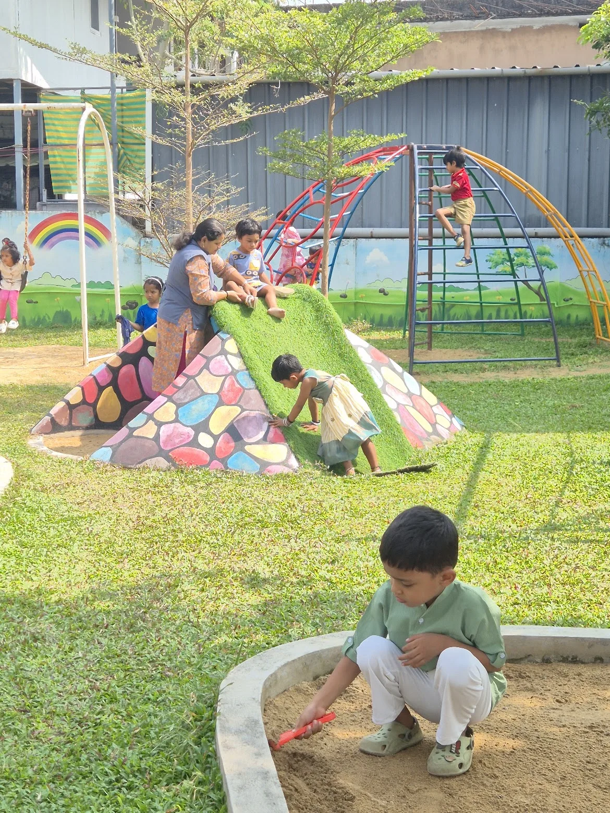
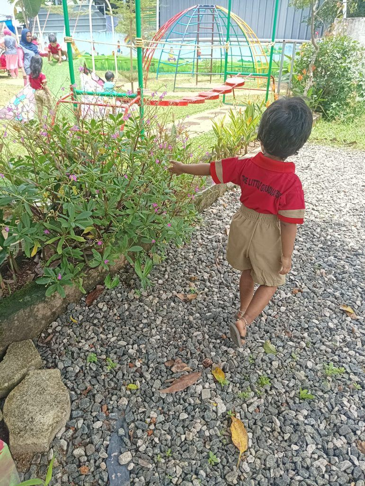

Parents ask about field trips in two ways. Will my child be looked after? And what will they learn once they are out?

Both are fair. From one and a half to six, an outing is a short morning, kept close. The photographs here are from our garden and playground in Kaloor. A field trip is the next small step, past that gate.

## How we look after children on an outing

We look at the place before any child goes. Someone from school visits, or speaks with the people there, and walks the route a small child would take. Shade, somewhere to sit, the toilets, the noise, and a clear way in and out. If it is too big, too hot, or too hurried for this age, we choose another place.

Parents hear the plan first. Where we are going, how long we expect to be away, and what to send. We ask for consent. A child comes because a parent has agreed, and knows the plan.

There are more adults than on a usual school day. Children go in small groups, each with one named adult who stays with them. We count before we leave, each time the group moves, and again before we come back.

Each child wears a tag or a card with the school phone number, so a person nearby can call us if a child and their group are briefly apart. Before we set out, we say it in plain words. Stay with your group. Hold a hand near the road. If you cannot see your teacher, stand still and call out.

Water and a familiar snack come with us, and a first-aid kit. Kochi weather is in the plan. Hats and shade when the sun is hard. A light cover when the rain comes in. We know which toilet we will use, and children go with their adult, a few at a time.

If we travel by vehicle, seats and belts are checked before the door shuts, and each child has a place chosen beforehand. The trip stays short and suits the age. A younger group may only look, drink, and come home. An older group can stay to watch someone at work. Parents get an update during the morning.

## What children learn outside

Montessori spoke of going out. Children understand the world by meeting it. At this age, that is a short real experience, with an adult nearby. A leaf in the hand. A person doing their job.

The senses lead. The smell of a market. Rain on a hot path. Grass that is cool, then full of ants. Words stick because a child can point at the thing. Jackfruit. Ferry. Stamp. Weighing scale.

Counting and sorting come on the walk. Steps to a gate. Big leaves and little ones. Smooth stones and rough ones. A child who sorts colours on a classroom mat can sort seed pods on a path.

Social skills show up in the small waits. A queue. Please and thank you to someone who is not their teacher. A place that is a little new, and still manageable, builds confidence. Carrying their own bag, holding their bottle, and waiting their turn builds independence.

They notice the season, the plants, and the animals, when we leave room. In Kochi, a tree after rain, a crow on a wall, a fish near the water. Community helpers become faces: the person at the counter, the person sorting the post, the person sliding the bread trays out.

Places that suit little children here are usually close. A nearby park. A market, kept short. A fire station or a post office, when they are glad to have small visitors. A farm or a garden. A little time by the backwaters, mostly for looking. A bakery, where the work is easy to see. We would pick whatever fits that morning.

Our garden is practice for the same looking, with an adult close by.

## The trip comes back to class

The next day, children talk about what they saw, and they draw it. A story comes out, one line or many. Matching cards can sit on a mat, a picture beside the thing it shows. A nature table can hold a leaf, a seed, or a ticket, whatever was fine to bring back.

## A small outing of your own

A Saturday around Kochi can hold the same idea, close to home.

At the grocery shop, let your child carry one item. Name the fruit. Count the plantains. Let them feel which bag is lighter.

A walk is enough: the lane, a park, the wall where the ants are. Stop when your child stops. A temple courtyard or a church courtyard, if it is already part of your week, is a slow place to look up. The beach is sand, shells, and wind. Morning and late afternoon are the kinder hours in Kochi.

Let your child lead for a stretch, and ask the questions. Answer the one they asked. Often it is enough to say that you see it too. Take water, know where you can sit, and hold hands near the road.

## The short version

Check the place, tell parents, and go with more adults than a usual day. Small groups, a named adult, counts along the way, a tag with the school number, and a few simple words about staying together. Back in class they talk, draw, and keep a little of it on the table.

If you would like to see an ordinary morning with us, garden included, you are welcome to visit us in Kaloor and sit for a while.
